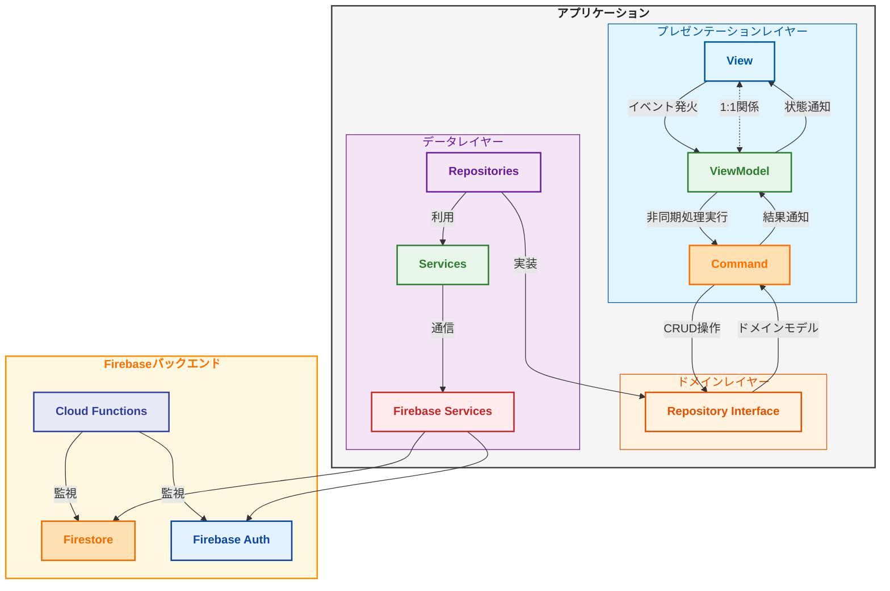

# 家計簿アプリ アーキテクチャ概要

## アーキテクチャ図



## アーキテクチャの説明

### 1. プレゼンテーションレイヤー
- **View**: UIを構築するウィジェット
  - アプリケーションデータをユーザーに表示する方法を記述
  - Flutterウィジェットの組み合わせで機能を構成
  - ユーザー操作に応じてイベントをViewModelに渡す役割を持つ
  - ビジネスロジックは含まず、単純な条件分岐、アニメーション、レイアウト、ルーティングのみを含む
- **ViewModel**: UIの状態管理とビジネスロジックの呼び出し
  - Repositoryからデータを取得し、UI表示用に適切な形式に変換
  - Viewが必要とする状態を管理し、データを失わずに再描画を可能にする
  - **コマンドパターン**を利用して非同期処理をカプセル化
    - Repositoryに対するCRUD操作は`AsyncCommand`クラスを使用
    - 実行状態（実行中、完了、エラー）を管理し、Viewに通知
    - コマンド自身が`ChangeNotifier`を継承し、状態変化を監視可能
    - 複数の非同期処理を整理し、ViewModelの複雑度を低減

  ※ ViewとViewModelは1:1の関係を持ち、一つの機能（フィーチャー）を定義します。

### 2. ドメインレイヤー
- **Repository Interface**: データ操作の抽象化
  - 実装の詳細を隠し、データアクセスのためのインターフェースを定義
  - 具体的なデータソースからビジネスロジックを分離
  - ドメインモデルとエンティティを定義
  - Single Source of Truthであり、アプリケーションデータの信頼できる単一の情報源
  - アプリケーション全体で一貫したデータ状態を維持
  - 複数のViewModelが参照する共通のデータソースを提供

  ※ Repositoryの一部はインターフェースとしてDomain Layerに定義され、実装はData Layerに配置されます。

### 3. データレイヤー
- **Data Sources**: リポジトリの具象実装＆ローカルDBやAPIとの連携
  - **Repositories**: ドメインレイヤーで定義されたリポジトリインターフェースの実装。Serviceを使用してデータを取得し、ドメインモデル（値オブジェクト）に変換する役割を持つ。各リポジトリは特定のデータ種別（収入、支出など）に対する操作を担当し、対応するドメインモデルを返す。
  - **Services**: 外部サービス（Firestore等）へのアクセスを抽象化し、データの取得・保存のための低レベルな操作を提供する。複数のリポジトリから共通して利用され、生のデータ（Map<String, dynamic>など）を返す。状態を保持せず、純粋なデータアクセス機能のみを提供する。

  ※ 本プロジェクトでは、RepositoriesとServicesは明確に分離され、それぞれ異なる責務を持っています。Repositoryはドメインモデルへの変換を担当し、Serviceは外部サービスとの通信を担当します。両方とも「Data Layer」に属します。

### 4. インフラストラクチャ
- **Firebase Services**: クラウドサービス連携
  - **Firestore**: ドキュメントデータベース
  - **Firebase Authentication**: ユーザー認証
  - **Cloud Functions**: サーバーレス関数

## 特徴
- 依存関係は内側から外側に向かう
- 各レイヤーは独立してテスト可能
- ビジネスロジックはUIやデータソースから分離
- Firebaseをバックエンドサービスとして活用

## レイヤー間通信の具体例

### ViewModelからRepositoryの呼び出し

ViewModelはコマンドパターンを使用してRepositoryを呼び出します。これにより、非同期処理の状態管理が容易になります。

```dart
// ViewModel内でのCommand使用例
class SettingsViewModel with ChangeNotifier {
  SettingsViewModel({
    required PublicProfileRepository publicProfileRepository,
    required AuthRepository authRepository,
  })  : _publicProfileRepository = publicProfileRepository,
        _authRepository = authRepository {
    init = AsyncCommand(this._init)..call(_authRepository.getCurrentUser().uid);
    // コマンドの初期化と即時実行
  }

  /// 初期化コマンド
  late final AsyncCommand<UserIdVo> init;

  /// ユーザー名保存コマンド
  late final AsyncCommand<String> save;

  // ...

  Future<void> _init(UserIdVo userId) async {
    _userNameBeforeEdit = await _publicProfileRepository.fetchUserName(userId);
    save = AsyncCommand((newUserName) => this._save(userId, newUserName));
  }

  Future<void> _save(UserIdVo userId, String newUserName) async {
    if (UserNameVo.isNotValid(newUserName)) {
      _hasValidationError = true;
      notifyListeners();
      return;
    }
    
    // 値オブジェクトの生成
    final vo = UserNameVo(newUserName);

    try {
      // リポジトリ呼び出し
      await _publicProfileRepository.updateUserName(userId, vo);
      _userNameBeforeEdit = vo;
    } catch (e) {
      // エラーハンドリング
      rethrow;
    } finally {
      _isEditing = false;
      notifyListeners();
    }
  }
}
```

### コマンドパターンの実装

コマンドパターンは非同期処理の状態管理を容易にします。

```dart
class AsyncCommand<T> extends _AsyncCommandBase {
  AsyncCommand(this._command);

  final Future<void> Function(T) _command;

  Future<void> call(T t) async {
    return _execute(() => _command(t));
  }
}

class _AsyncCommandBase with ChangeNotifier {
  /// コマンドを実行可能かどうか
  bool _canExecute = true;
  bool get canExecute => _canExecute;
  bool get isExecuting => !canExecute;

  /// エラー状態
  Exception? _error;
  Exception? get error => _error;
  bool get hasError => _error != null;

  Future<void> _execute(Future<void> Function() command) async {
    if (!canExecute) {
      return;
    }

    _canExecute = false;
    notifyListeners();

    try {
      await command();
      _error = null;
    } on Exception catch (ex, st) {
      // エラーログ記録
      developer.log(
        'AsyncCommand execution was failed',
        name: 'AsyncCommand',
        level: Level.WARNING.value,
        error: ex,
        stackTrace: st,
      );
      _error = ex;
    } finally {
      _canExecute = true;
      notifyListeners();
    }
  }
}
```

## エラーハンドリング戦略

本プロジェクトでは、各レイヤーの責務と特性に応じて異なるエラーハンドリング戦略を採用している。

### レイヤー別エラーハンドリング方針

#### 1. Data Layer: Either<Exception, T>による安全なデータアクセス

データ層では`dartz`パッケージの`Either<Exception, T>`を使用してエラーを安全に管理する。

```dart
// Repository実装例
class FirestorePersonalIncomeRepository implements IncomeRepository {
  @override
  Future<Either<Exception, List<IncomeVo>>> fetchMonthly(DateTime date) async {
    try {
      final querySnapshot = await _db
        .collection('/personalNotes/${_uid.value}/incomes')
        .whereInThisMonth('date', date)
        .get();
      
      final incomes = querySnapshot.docs
        .map((doc) => IncomeVo(doc.data()['amount']!))
        .toList(growable: false);
        
      return Right(incomes);
    } on FirebaseException catch (e) {
      return Left(RepositoryException('Firebase error: ${e.message}'));
    } catch (e) {
      return Left(RepositoryException('Unknown error: $e'));
    }
  }
}
```

**目的**: 
- 外部API/DBアクセスの安全性確保
- コンパイル時エラーハンドリングの強制
- 関数型プログラミングの恩恵活用

#### 2. Presentation Layer: Exception + Commandパターンによる実行状態管理

プレゼンテーション層では、UIに適したException + Commandパターンを採用している。

```dart
// ViewModelでのEither → Exception変換
Future<void> _initializeData(DateTime date, UserIdVo userId) async {
  try {
    final incomeResult = await _incomeRepository.fetchMonthly(date);
    final List<IncomeVo> incomeList = incomeResult.fold(
      (exception) => throw exception,  // レイヤー境界での例外変換
      (incomes) => incomes,
    );
    
    // データの更新
    value = processedData;
  } catch (ex) {
    value = _emptyInfo;
    rethrow; // Commandに例外を委譲
  }
}
```

**`rethrow`を許容する理由**:
- **レイヤー責務の分離**: Eitherはデータ安全性、Commandは実行状態管理
- **Flutter慣例との整合**: Flutter UIは例外ベースエラーハンドリングが標準
- **実装の簡潔性**: UI状態管理の複雑性を最小化
- **Commandでの統一処理**: `try-catch`による一貫したエラー状態管理

#### 3. Command Pattern: UI向け実行状態の統一管理

```dart
class _AsyncCommandBase with ChangeNotifier {
  bool _canExecute = true;
  bool get canExecute => _canExecute;
  bool get isExecuting => !canExecute;

  Exception? _error;
  Exception? get error => _error;
  bool get hasError => _error != null;

  Future<void> _execute(Future<void> Function() command) async {
    if (!canExecute) return;

    _canExecute = false;
    notifyListeners();

    try {
      await command();
      _error = null;
    } on Exception catch (ex) {
      _error = ex; // UI用エラー状態管理
    } finally {
      _canExecute = true;
      notifyListeners();
    }
  }
}
```

**メリット**:
- 重複実行防止
- 統一されたローディング・エラー状態
- UIとの自然な統合
- テスタビリティの向上

### アーキテクチャの一貫性について

この設計により以下が実現される：

1. **Data Layer**: `Either<Exception, T>`で安全なデータ取得・変換を保証
2. **Presentation Layer**: `Exception + Command`でUIに適した実行状態管理
3. **レイヤー境界**: `rethrow`によるクリーンな例外変換

各レイヤーが最適なパターンを採用することで、理論的純粋性よりも**実用性と保守性**を優先している。
