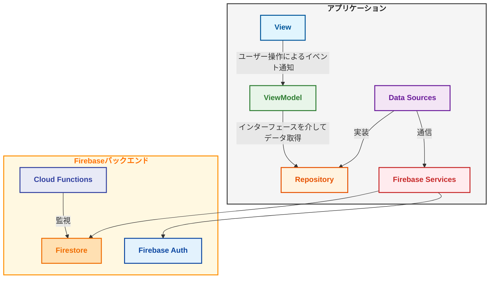

# 家計簿アプリ アーキテクチャ概要

## アーキテクチャ図



## アーキテクチャの説明

### 1. Presentation Layer (プレゼンテーション層)
- **View**: UIを構築するウィジェット
- **ViewModel**: UIの状態管理とビジネスロジックの呼び出し

### 2. Domain Layer (ドメイン層)
- **Repository Interface**: データ操作の抽象化

### 3. Data Layer (データ層)
- **Data Sources**: リポジトリの具象実装＆ローカルDBやAPIとの連携

### 4. Infrastructure (インフラストラクチャ)
- **Firebase Services**: クラウドサービス連携
  - **Firestore**: ドキュメントデータベース
  - **Firebase Authentication**: ユーザー認証
  - **Cloud Functions**: サーバーレス関数

## 特徴
- 依存関係は内側から外側に向かう
- 各レイヤーは独立してテスト可能
- ビジネスロジックはUIやデータソースから分離
- Firebaseをバックエンドサービスとして活用

## ディレクトリ構造

```
household_accounts/
├── lib/
│   └── v2/
│       ├── presentation/    # プレゼンテーション層
│       ├── domain/         # ドメイン層
│       └── data/           # データ層
└── ...

household_accounts_firebase/
├── firestore.rules      # Firestoreセキュリティルール
├── firebase.json        # Firebase設定
└── functions/           # Cloud Functions
    └── src/
        └── index.ts  # バックエンドロジック
```

※ このドキュメントはプロジェクトの`v2`ディレクトリと`household_accounts_firebase`の構造に基づいています。
