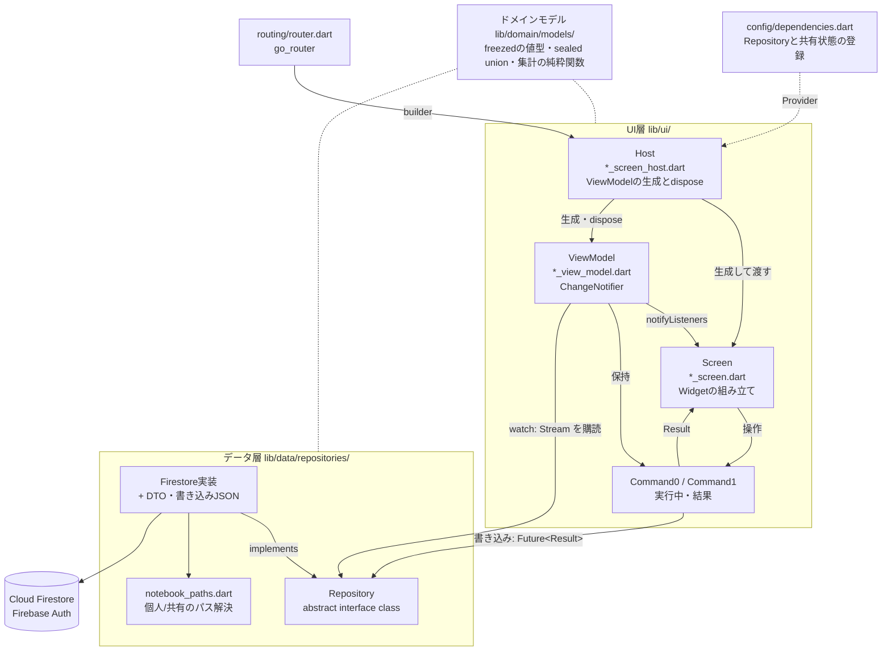

# 家計簿アプリ アーキテクチャ

このドキュメントは、アプリの構造と、その構造を選んだ理由をまとめたものである。コードと食い違ったら、コードに合わせてこのドキュメントを直す(ライブドキュメント)。

- 規約(命名・設計ルール・テスト方針・使用ライブラリ)は [style_guide.md](./style_guide.md) にある
- Firestoreのデータ構造と制約は [firestore_schema.md](./firestore_schema.md) と [firestore_constraints.md](./firestore_constraints.md) にある
- 設計の経緯は [刷新案](./features/202608_architecture_redesign.md) と [移行計画](./features/202608_architecture_migration_plan.md) にある(どちらも当時のスナップショット。現在の正はこのドキュメント)

## 1. 全体像

Flutter公式の [App architecture](https://docs.flutter.dev/app-architecture) ガイドのMVVMを、このアプリの規模(1人開発・CRUDと期間集計が中心)に合わせて小さくしたもの。

- **UI層とデータ層の2層**に、両方から使う**ドメインモデル**を加えた構成。UseCase層(ドメイン層)は置かない。集計のように画面をまたぐロジックは、ドメインモデルの純粋関数(`RecordSummary.from`・`BudgetSummary.from` など)にする
- 依存の向きは UI層 → データ層 の一方向。ドメインモデルはどちらからも参照される
- 一覧系の読み取りはFirestoreの `snapshots()` を購読する(watch)。他の端末やペア相手の変更が、画面を開き直さなくても反映される
- 書き込みは `Future<Result<T>>` を返し、ViewModelは `Command` で実行状態ごと扱う



## 2. フォルダ構成

```text
lib/
├── main.dart              # Firebase初期化(デバッグ時はエミュレータ接続)、MultiProvider、MaterialApp.router
├── firebase_options.dart  # FlutterFire CLIの生成物
├── config/
│   └── dependencies.dart  # appProviders(): Repositoryと共有状態のProvider登録一覧
├── routing/
│   ├── router.dart        # createRouter(): 認証redirect、シェル内外のルート、ノート単位のHost再生成
│   └── routes.dart        # パス定数
├── domain/
│   └── models/            # ドメインモデル(1型1ファイル)
├── data/
│   └── repositories/      # 機能ごとに 抽象 + Firestore実装 + DTO を同居させる
│       ├── auth/
│       ├── profile/
│       ├── record/
│       ├── category/
│       ├── property/
│       └── firestore_shared/   # notebook_paths.dart
├── ui/
│   ├── core/              # 画面をまたいで使うもの
│   │   ├── selected_notebook.dart  # 選択中のノート(SelectedNotebook / NotebookKind)
│   │   ├── formatter.dart          # 金額の表示形式(Formatter.simpleCurrency)
│   │   ├── themes/theme.dart
│   │   └── widgets/                # 削除確認ダイアログなど
│   ├── auth/              # サインイン画面(firebase_ui_authを包む)
│   ├── shell/             # ボトムナビ + Drawer(ノート切替・設定・ログアウト)
│   ├── dashboard/
│   ├── record_entry/
│   ├── calendar/          # 月次カレンダー + 日次明細
│   ├── properties/        # 資産一覧 + 資産エディタ
│   ├── categories/        # カテゴリ一覧 + カテゴリエディタ
│   ├── budget/
│   └── settings/
└── utils/
    ├── result.dart        # Result<T>
    ├── command.dart       # Command0 / Command1
    └── combine_latest.dart  # combineLatest3(3本のStreamの結合)
```

UIの1機能のフォルダは次の形にする(例: `lib/ui/properties/`)。

```text
properties/
├── properties_screen.dart          # 画面のWidget
├── properties_screen_host.dart     # ViewModelを画面と同じ寿命で持つ
├── properties_view_model.dart
├── property_editor_screen.dart     # 同じ機能の2画面目は同じフォルダに置く
├── property_editor_screen_host.dart
├── property_editor_view_model.dart
└── widgets/                        # この機能だけで使うWidget
```

テストは `lib/` と同じ構成で `test/` に置く。テスト用の手書きFakeとgoldenのヘルパーは `test/test-util/`、integrationテストのUI操作とデータ投入のヘルパーは `integration_test/util/` にある。

`packages/household_lints/` は、Repositoryの規約を `dart analyze` で機械的に検証するanalyzer pluginである(§7.1)。

## 3. UI層

### 3.1 Screen・Host・ViewModel

| 役割 | 内容 |
|---|---|
| Screen | Widgetを組み立てるだけ。ViewModelをコンストラクタで受け取り、`ListenableBuilder` で購読する。ロジックは持たない |
| Host | ViewModelを `StatefulWidget` の `initState` で生成し、`dispose` で破棄する。Repositoryは `context.read()` で取り出して渡す |
| ViewModel | `ChangeNotifier`。画面の状態を持ち、Repositoryのwatchを購読し、書き込みを `Command` として公開する |

ViewModelはProviderに登録しない。Providerはアプリ全体で長く生きるもの(Repositoryと共有状態)のためのもので、ViewModelは画面と同じ寿命にするためHostで持つ。ViewModelとScreenは1対1で対応する。

```dart
// lib/ui/properties/properties_screen_host.dart
class _PropertiesScreenHostState extends State<PropertiesScreenHost> {
  late final PropertiesViewModel _viewModel;

  @override
  void initState() {
    super.initState();
    _viewModel = PropertiesViewModel(propertyRepository: context.read());
  }

  @override
  void dispose() {
    _viewModel.dispose();
    super.dispose();
  }

  @override
  Widget build(BuildContext context) => PropertiesScreen(viewModel: _viewModel);
}
```

新しい画面は、ノートに依存するかどうかにかかわらずHostを作る。設定画面だけは例外で、Hostを作らずルートのbuilder(`router.dart` の `Routes.settings`)が `SettingsViewModel` を直接生成している。このViewModelは誰もdisposeせず、builderが再実行されると新しいViewModelが作られて読み込みもやり直しになる。それでも問題にならないのは、`SettingsViewModel` がStreamの購読を持たず(ユーザー名の読み込みと保存の `Command` だけ)、破棄されなくても解除し損なう購読がないからである。購読を持つViewModelをこの形で作ってはいけない。

### 3.2 Command

ユーザー操作から始まる「完了する非同期処理」(保存・削除・ログアウト、画面を開いたときの単発の読み込み)は `Command0`(引数なし)/ `Command1`(引数1つ)で包む(`lib/utils/command.dart`。公式の [Commandパターン](https://docs.flutter.dev/app-architecture/design-patterns/command) と同じ形)。

- `running`(実行中)と `result`(直近の `Result`)を `ChangeNotifier` として公開する。実行中に再度呼ばれても実行しない(二重タップ防止)
- 成功・失敗の一度きりの通知(スナックバーなど)は、ScreenがCommandにリスナーを付けて出し、表示したら `clearResult()` する
- 完了せずに流れ続けるwatchの購読はCommandに載せない。購読の結果はViewModelのフィールドで表す

```dart
// lib/ui/properties/properties_view_model.dart
delete = Command1(propertyRepository.delete);
_propertiesSubscription = propertyRepository.watchAll().listen(
  _onProperties,
  onError: _onPropertiesError,
);
```

### 3.3 入力の検証

入力の検証はUI層の関心事として、ViewModelの状態(エラーの有無・保存できるか)で表す。保存のCommandは**検証済みの型だけ**を引数に取り、検証漏れを型で防ぐ。

```dart
// lib/ui/settings/settings_view_model.dart
late final Command1<void, UserName> saveUserName;

// lib/ui/properties/property_editor_view_model.dart
late final Command1<void, ({PropertyName name, int balance})> save;
```

- 入力が変わるたびに検証し(ライブ検証)、不正なら保存ボタンを押せなくする
- 判定は値型の `isValid` など、入力を引数に取る純粋関数で行う(コンストラクタの検証条件と同じ判定を使う)
- 入力フォーマッタで文字を取り除いて値を書き換えない。不正な入力は不正なまま検証にかけて拒否する
- そのため `Command` の失敗(`Result.error`)は、データ層から来た失敗だけを表す

### 3.4 購読の管理

- **表示期間の切り替えはViewModelが購読を張り替える**。カレンダーの月送り(`CalendarViewModel`)、予算画面の期間送りとモード切替(`BudgetViewModel`)は、表示中の期間をViewModelの状態として持ち、期間が変わったら古い購読を `cancel` して新しい期間で `watchPeriod` を購読し直す。新しい期間の値が届くまではローディングに戻し、前の期間の値やエラーは引き継がない。同じ画面上の操作なので、ViewModelは作り直さない
- **ノートの切り替えはHostを作り直す**(§6)。期間の切り替えと違い、Repositoryそのものが入れ替わるため
- **複数のStreamを購読するViewModelは、最新値とエラーを購読ごとに持つ**(記録入力のカテゴリ2本と資産、日次明細の記録・カテゴリ2本・資産、予算画面のカテゴリと記録、カテゴリ一覧の収入・支出の2セクション)。ある購読の正常な値で消してよいのはその購読自身のエラーだけで、エラーを出した購読は、後から正常な値が届いた時点で回復する。1つのフィールドで共有すると、失敗していない別の購読の値がエラーを消してしまい、失敗した購読の値は届かないままなので、ローディング表示から抜け出せなくなる。カテゴリ一覧は2つのセクションの状態を別々に表示し、それ以外は全部の値がそろうまでローディング、どれか1つでもエラーなら画面のエラーにする
- **「今日」はViewModelに注入した時計(`DateTime Function()`。カレンダーと予算画面は `now`、記録入力は `clock`)から取る**。本番は `DateTime.now` のままで、テストが日付を固定するために差し替える。「次の期間へ進めるか」のような今日に依存する判定は、評価のたびに `now()` を呼び直す
- **時間の経過による再描画はHostがアプリの復帰をきっかけに頼む**。時間の経過には通知がないので、タブが `IndexedStack` に残ったまま月や月度をまたぐと、次へ進むボタンが無効のまま残る。カレンダーと予算画面のHostは `WidgetsBindingObserver` で `AppLifecycleState.resumed` を受け、ViewModelの `refreshCurrentMonth()`(カレンダー。月が変わっていれば通知する)/ `refreshToday()`(予算画面。月度が16日で切り替わるので日単位で比べる)を呼ぶ

### 3.5 シェル

`lib/ui/shell/` はボトムナビ(6タブ)とDrawerを持つ。`ShellViewModel` は次を担当する。

- `ProfileRepository.watchPairStatus` を購読し、ペアの有無を `SelectedNotebook.updatePairId` へ反映する。ノートを切り替えられるかは `SelectedNotebook.pairId` から決める(ペアの有無の情報源は `SelectedNotebook` の1つだけ)
- Drawerからのノート切替(`SelectedNotebook.select`)
- ログアウト(`Command0`)

### 3.6 サインイン

サインイン画面は `lib/ui/auth/sign_in_screen.dart` にあり、中で firebase_ui_auth の `SignInScreen` を返すだけである。firebase_ui_authをimportするのはこのフォルダだけにして、将来差し替えるときの変更をここに閉じ込める。状態はfirebase_ui_authが持つので、ViewModelは作らない。

## 4. ドメインモデル

`lib/domain/models/` に置く。すべて不変である。クラスはfreezedで生成し、値を束ねるだけの小さな組は名前付きrecordの `typedef` にする(`BalanceEffect` = `({PropertyId propertyId, int delta})`、`CategorySpending` = `({ExpenseCategory category, int spent})`)。1つのファイルに1つの型を置く。

| 種類 | 例 | 方針 |
|---|---|---|
| ID | `RecordId` `CategoryId` `PropertyId` `UserId` `PairId` | freezedの値型。空文字は `ArgumentError` |
| 検証付きの値 | `Amount`(1以上) `RecordNote`(100文字以下) `CategoryName` `PropertyName` `UserName`(1〜20文字) `Budget`(0以上) | コンストラクタで検証し、不正なら `FormatException` |
| 検証のない値 | 資産の残高 `Property.balance`(`int`) | 値型で包まない |
| 例外: 検証のない値型 | 記録の日付 `RecordDate` | 値型にするが、コンストラクタで検証しない。旧UIは未来日付を保存できたため本番に未来日付の記録がありうるうえ、integrationテストのシードにも月末23:59:59の記録(実行日によっては未来日付になる)があるので、ここで拒否すると読み込みそのものが失敗する。未来日付は記録入力の入力境界で拒否する(DatePickerの `lastDate` を今日にし、保存時にも `submit` で確かめる) |
| エンティティ | `Record`(収入/支出/振替のsealed union)`IncomeCategory` `ExpenseCategory` `Property` | freezed |
| 内容と保存済みの区別 | `RecordContent`(これから書く記録の内容) / `Record`(IDを持つ保存済みの記録。`record.content` で内容を取り出せる) | 残高への寄与(`balanceEffects`)は `RecordContent` に1か所だけ定義する |
| 期間 | `Period`(半開区間 `[start, end)`。`calendarMonth`・`day`)/ `FiscalMonth`(前月16日〜当月15日の「月度」) | Repositoryの期間指定はすべて `Period` で受ける |
| ノート | `Notebook`(`personal(UserId)` / `shared(PairId)` のsealed union) | 個人ノートと共有ノートの違いはFirestoreのルートパスだけ |
| 認証・ペア | `UserAuth`(`UserAuthSignedIn` / `UserAuthNotSignedIn`)/ `PairStatus` | sealed union |
| 集計 | `RecordSummary.from` `DailySummary.byDay` `BudgetSummary.from` | 純粋関数 |

表示用の文言(「削除済み」など)はドメインに置かず、Widget層で付ける。ドメインの例外メッセージは原因調査のための事実を書くだけにする。

## 5. データ層

### 5.1 Repository

Repositoryは5つある。どれも `lib/data/repositories/<機能>/` に、抽象(`<機能>_repository.dart`)とFirestore実装(`firestore_<機能>_repository.dart` / `firebase_auth_repository.dart`)を同居させる。抽象は `abstract interface class` で、テストでは手書きのFakeに差し替える。

| Repository | 主なAPI |
|---|---|
| `AuthRepository` | `authStateChanges()` `getCurrentUser()` `signOut()` |
| `ProfileRepository` | `watchPairStatus(UserId)` `fetchUserName` `updateUserName` |
| `RecordRepository` | `watchPeriod(Period)` `add(RecordContent)` `delete(Record)` |
| `CategoryRepository` | 収入・支出それぞれの `watch*` `add*` `update*` `delete*` |
| `PropertyRepository` | `watchAll()` `add` `update` `delete` |

- 読み取りは素の `Stream<T>`、失敗しうる単発の操作は `Future<Result<T>>` を返す。失敗しない同期の読み取り(`getCurrentUser`)は素の `T` を返す
- 抽象のdocコメントには、呼び出し側が頼ってよい契約(初回emitの条件・並び順・失敗する条件など)だけを書き、実装の詳細は書かない
- カテゴリは収入と支出でメソッドを分ける。支出だけが予算を持つため、種別を引数で受ける1つのメソッドにはしない

### 5.2 個人ノートと共有ノート

`personalNotes/{uid}` と `sharedNotes/{pairId}` は同じ構造のサブコレクションを持つ。違いはルートパスだけなので、Repositoryの実装は1データ種別につき1クラスにし、コンストラクタで `Notebook` を受け取る。パスの組み立ては `notebook_paths.dart` の1か所にまとめる。

```dart
// lib/data/repositories/firestore_shared/notebook_paths.dart
String notebookPath(Notebook notebook) => switch (notebook) {
  PersonalNotebook(:final uid) => 'personalNotes/${uid.value}',
  SharedNotebook(:final pairId) => 'sharedNotes/${pairId.value}',
};
```

どのノートを開いているかは `SelectedNotebook` が持ち、Providerがその変化に合わせてRepositoryを作り直す(§6)。

### 5.3 DTOと書き込みJSON

- Service層(コレクション単位の薄いラッパー)は置かない。Repository実装が `cloud_firestore` を直接使う。テストの差し替え口はRepositoryの抽象で足りるため、間にもう1層置いても得るものがない
- ノートの中身を扱うRepository(記録・カテゴリ・資産)では、読み取りはDTO(`IncomeRecordDto` など)がドキュメントを読み、`toDomain()` でドメインモデルへ変換する。フィールドの欠損・型の不正は `FormatException` にする。収入・支出・振替はドキュメントの形が似ていても別のDTOにする
- 同じく書き込みのJSONは、DTOファイル内のトップレベル関数(`incomeRecordJson`・`propertyCreateJson`・`propertyUpdateJson` など)で組み立てる
- `FirestoreProfileRepository` はDTOを持たず、ドキュメントのフィールド(ユーザー名・`sharedNote.ref`)を直接読み書きする。そのため失敗の形も上と違う: 公開プロフィールにユーザー名が無いときは素の `Exception`、名前が不正なら `UserName` の `FormatException`、`privateProfiles` の形が不正なときはキャストの失敗(`TypeError`。`Error` なので投げ直される)になる
- `withConverter` は使わない。読み取り(IDを持つ・参照は文字列)と書き込み(IDを持たない・`DocumentReference`・`serverTimestamp`)で型が一致せず、1つのコンバータに収まらないため
- 更新は渡されたフィールドだけを書く。名前だけ編集したのに残高も書き戻すと、編集中に入った残高の増減を古い値で上書きしてしまうため(エディタ側で変わったフィールドだけを渡す規約は [style_guide.md の「UI層」](./style_guide.md#43-ui層libui))
- 単体テストはDTOと書き込みJSONに対して書く。Firestoreへの購読・書き込みそのものはフェイクでは検証にならないので、integrationテストで確かめる

### 5.4 記録と資産残高

記録の作成・削除は資産の残高を増減させる。残高への寄与の計算はドメイン(`RecordContent.balanceEffects`)、原子的な適用は `RecordRepository` が受け持つ。原子性はストレージの性質で、データ層の内側でしか守れないため、UseCaseで2つのRepositoryを順に呼ぶ形にはしない。

- **作成(`add`)は `WriteBatch`**。読み取りを伴わないので、原子性はトランザクションと同じで、そのうえオフラインでもローカルに即時反映され、復帰後に同期される
- **削除(`delete`)は `runTransaction`**。打ち消す金額は保存されているレコードを読み直した値を正とするため、読み取りと書き込みを一体で行う
- 使い分けの基準は「読み取りを伴うかどうか」。トランザクション実行用の共通部品(transaction_runner)は作らず、必要なRepositoryに直接書く
- 記録には常に `hasCheckedOut: true` を書く。削除時の打ち消しは `hasCheckedOut` がtrue(または欠損)の記録だけに行う
- 削除時に参照先の資産が既に無い場合は、その資産の打ち消しを飛ばしてレコードの削除は成功させる

```dart
// lib/data/repositories/record/firestore_record_repository.dart(抜粋)
batch.set(_collection(collectionName).doc(), json);
for (final effect in record.balanceEffects) {
  batch.update(_collection('properties').doc(effect.propertyId.value), {
    'amount': FieldValue.increment(effect.delta),
  });
}
await batch.commit();
```

### 5.5 資産・カテゴリの削除

資産とカテゴリは、参照している記録があっても削除する(削除ガードを入れない)。

- クライアントSDKのトランザクションはクエリを読めないので「参照の照会 → 削除」を原子的にできない。オフライン時はキャッシュに対する照会になり、参照を見落とす。ガードを入れても確実には防げない
- 誤操作は削除前の確認ダイアログで防ぐ
- 削除された資産・カテゴリを参照する記録は残る。画面側で「削除済み」として表示する(日次明細の名前、予算画面の「削除済み」行)

## 6. 依存性の注入(DI)

DIは `provider` だけを使う。`lib/config/dependencies.dart` の `appProviders()` が、`main.dart` の `MultiProvider` に渡す一覧を返す。

| 登録 | 内容 |
|---|---|
| `ChangeNotifierProvider<SelectedNotebook>` | 選択中のノート。複数の画面にまたがるUIの状態なので `lib/ui/core/` に置く |
| `Provider<AuthRepository>` / `Provider<FirebaseFirestore>` / `Provider<ProfileRepository>` | ノートに依存しないもの |
| `StreamProvider<UserAuth>` | 認証状態。`lazy: false` が必須(誰も読まないまま最初にreadされると、起動時の古い `initialData` が返り、誤ったuidでRepositoryが作られる) |
| `ProxyProvider2<SelectedNotebook, UserAuth, XxxRepository>` | `RecordRepository`・`CategoryRepository`・`PropertyRepository`。ノートか認証状態が変わるたびに、解決した `Notebook` で作り直す |

`SelectedNotebook` は `kind`(`NotebookKind.personal` / `shared`)と `pairId` を持ち、`resolve(UserId)` で `Notebook` を返す。`updatePairId(null)`(ペアの解消)は、共有ノートを選んでいた場合に個人ノートへの切り替えも同じ通知で行う。

### ノート切替とViewModelの作り直し

ノートを切り替えると、Repositoryが新しいノート用に作り直される。古いRepositoryを購読しているViewModelを残さないよう、ノートに依存する画面は**HostごとViewModelを作り直す**。ルート側で `SelectedNotebook` を `watch` し、Hostに `ValueKey(notebook)` を付ける。キーが変わるとHostのStateが作り直され、古いViewModelのdispose(購読解除)と新しいViewModelの生成が必ず対になる。

```dart
// lib/routing/router.dart(抜粋)
GoRoute(
  path: Routes.properties,
  builder: (context, state) => _notebookScoped(
    (notebook) => PropertiesScreenHost(key: ValueKey(notebook)),
  ),
),
```

切替はまれな操作なので、Streamをつなぎ替える仕組みより、作り直す単純さを選んでいる。そのため、ノートを切り替えると画面の表示期間などの状態は初期値に戻る。

## 7. エラー処理

### 7.1 Result と Result.guard

`Result<T>`(`lib/utils/result.dart`)は `Ok<T>` / `Error<T>` のsealed classで、公式の [Resultパターン](https://docs.flutter.dev/app-architecture/design-patterns/result) と同じ形である。

Repository実装の `Future<Result<T>>` を返す公開メソッドは、本体を `Result.guard(...)` の1行にする。try/catchを手書きしないことで、catch節の書き漏れを構造的に防ぐ。

```dart
// lib/data/repositories/property/firestore_property_repository.dart
@override
Future<Result<void>> delete(PropertyId id) =>
    Result.guard(() => _collection.doc(id.value).delete());
```

- `Result.guard` は `Exception` だけを `Result.error` にし、Dartの `Error`(実装の不具合)は捕まえずにそのまま投げる(fail fast)
- この規約は `packages/household_lints` のanalyzer pluginで検証する。対象は `lib/data/repositories/` 配下の、名前が `Repository` で終わるクラス。ルールは3つ: `Result.guard` を直接返す / 素の `Future`・`FutureOr` を返さない / 公開のgetter・setter・フィールドを持たない
- 検証には `dart analyze` を使う(`flutter analyze` を1回実行するだけではpluginの診断を取りこぼすことがある)

### 7.2 Streamのエラー

watchのエラーは `Stream<Result<T>>` にせず、素の `Stream<T>` のエラーとして流す。ViewModelは `listen` に必ず `onError` を付け、その中で `Exception` と `Error` を分ける。`Result.guard` と同じ区分である。

```dart
// lib/ui/properties/properties_view_model.dart
void _onPropertiesError(Object error, StackTrace stackTrace) {
  if (error is! Exception) {
    Error.throwWithStackTrace(error, stackTrace);
  }
  developer.log('資産の購読が失敗しました', name: 'PropertiesViewModel',
      level: Level.WARNING.value, error: error, stackTrace: stackTrace);
  _loadError = error;
  notifyListeners();
}
```

- `Exception`(想定内の失敗)はエラー状態にし、ログに残す。後続の正常な値が届いたらエラー状態を解く(回復する)
- `Error`(実装の不具合)はエラー表示に隠さず、`Error.throwWithStackTrace` で投げ直す
- 複数のStreamを結合する `combineLatest3` は、エラーを出したStreamが回復するまで出力を止める。古い値の組み合わせで「正常に見える」出力をしないため

### 7.3 値型の例外

検証付きの値型は、コンストラクタがどのビルドでも検証して例外を投げる(`assert` はリリースビルドで消えるので、値型の検証には使わない)。例外の種類で「想定内かどうか」を分ける。

| 値の出どころ | 例外 | 扱い |
|---|---|---|
| ユーザーが入力しうる値(`Amount`・`UserName` など) | `FormatException` | 想定内。ViewModelが受けて検証エラーの状態にする。DTOで読んだ値が不正なときもStreamの `Exception` として流れる |
| システムの内部で決まる値(IDなど) | `ArgumentError` | 不具合。捕まえずにfail fastさせる |

### 7.4 データの不正は発生源で防ぐ

ユーザーが自分で直せないデータの不正(Firestore上の値がドメインの制約を満たさないなど)で、エラー画面を出さないようにする。そのために、不正なデータを読み取り側で吸収するのではなく、**書き込む側で防ぐ**。

- アプリの入力画面で検証し、不正な値を保存できなくする
- Firestore Rules(`firebase/firestore.rules`)で、ドキュメントの形と値の制約を課す(金額1以上、メモ100文字以下、名前1〜20文字、予算0以上、振替元と振替先が別の資産、作成時の参照先の存在など)。読み取り時にドメイン型が検証して画面をエラーにしうる制約(金額・メモ・名前・予算・ドキュメントの形)について、Rulesがアプリより緩い点は直す対象である
- 未来日付の禁止はRulesに無く、記録入力の入力境界(DatePickerと保存時の確認)だけで行っている。Rulesは `date` がtimestampであることしか確かめない。読み取り時にも検証しない(`RecordDate` は検証のない値型。§4)ので、未来日付の記録があってもエラー画面にはならない
- 既存の不正データは本番を確認して直す

読み取り時のドメインの検証は残すので、不正なデータがあればその画面はエラー表示になる。ただしこれは上の予防により起きない状態を前提にしている。例外として、振替元と振替先が同じ資産の記録は、ドメイン型の `@Assert`(デバッグビルドだけで効く)で検出するだけにして、リリースビルドではそのまま表示する。通信や権限など、読み込みそのものの失敗はエラー表示でよい(再起動など、ユーザーが試せる対処があるため)。

## 8. ルーティング

`go_router` を使う(`lib/routing/router.dart`)。`GoRouter` は `main.dart` の `MyApp` のStateが作って破棄する(integrationテストがテストごとに新しいツリーを作るため、グローバルにしない)。

- **認証のredirect**: 未サインインなら `/sign-in` へ、サインイン済みで `/sign-in` にいれば `/dashboard` へ送る。redirectはProviderではなく `AuthRepository` を直接読む。`authStateChanges()` を `refreshListenable` にして、認証状態が変わると再評価する
- **シェル内のルート**: `StatefulShellRoute.indexedStack` の6ブランチ(`/dashboard` `/entry` `/calendar` `/properties` `/categories` `/budget`)。タブを切り替えても各タブの状態は残る
- **シェル外のルート**: ボトムナビを覆って表示する画面はルートレベルに置き、`context.push` で開く。設定(`/settings`)、日次明細(`/calendar/:date`。日付は `yyyy-MM-dd`)、エディタ(`/properties/new` `/properties/edit` `/categories/new` `/categories/edit`)
- **編集対象は `extra` で渡す**: 編集画面には編集する `Property` / `IncomeCategory` / `ExpenseCategory` を `extra` で渡す。型が違う値が来るのは実装の不具合なので、ルートのbuilderが `ArgumentError` を投げてfail fastさせる(モバイル専用のアプリなので、ブラウザ履歴で `extra` が失われる問題は起きない)
- **日次明細の日付パラメータ**: 値はアプリが `Routes.calendarDayOf` で組み立てるので、読めない値が来るのも実装の不具合である。builderは `DateTime.parse` をそのまま呼び、読めなければ `DateTime.parse` が投げる `FormatException` を誰も捕まえずに表へ出す。§7.3の区分では `FormatException` は想定内の失敗を表すが、ここでは受けて状態にする側がいないため、結果として不具合と同じくfail fastになる

## 9. Firebase

- バックエンドは同じリポジトリの `firebase/` にある(Firestore Rules、Cloud Functions、Hosting)。Cloud Functionsはユーザー作成時の初期化(`onCreateUser`)を行う
- デバッグビルドではAuthエミュレータ(9099)とFirestoreエミュレータ(8081)に接続し、Firestoreの永続化を切る(`lib/main.dart`)。ポートは `firebase/firebase.json` と一致させる
- 本番のFirestoreはプラットフォームの既定(モバイルではオフライン永続化が有効)で使う。watchの初回値はオフラインキャッシュから届くこともある

## 変更履歴

- 2026-11-08: アーキテクチャ移行(移行計画PR1〜PR9)の完了に合わせて全面改訂
