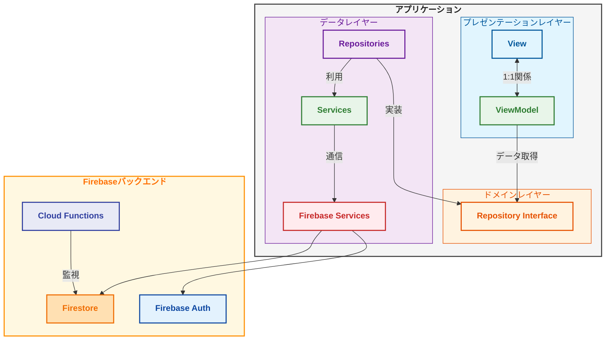

# 家計簿アプリ アーキテクチャ概要

## アーキテクチャ図



## アーキテクチャの説明

### 1. プレゼンテーションレイヤー
- **View**: UIを構築するウィジェット
  - アプリケーションデータをユーザーに表示する方法を記述
  - Flutterウィジェットの組み合わせで機能を構成
  - ユーザー操作に応じてイベントをViewModelに渡す役割を持つ
  - ビジネスロジックは含まず、単純な条件分岐、アニメーション、レイアウト、ルーティングのみを含む
- **ViewModel**: UIの状態管理とビジネスロジックの呼び出し
  - Repositoryからデータを取得し、UI表示用に適切な形式に変換
  - Viewが必要とする状態を管理し、データを失わずに再描画を可能にする
  - コマンド（コールバック関数）をViewに提供し、ボタン押下やフォーム送信などのイベントハンドラに接続できるようにする

  ※ ViewとViewModelは1:1の関係を持ち、一つの機能（フィーチャー）を定義します。

### 2. ドメインレイヤー
- **Repository Interface**: データ操作の抽象化
  - 実装の詳細を隠し、データアクセスのためのインターフェースを定義
  - 具体的なデータソースからビジネスロジックを分離
  - ドメインモデルとエンティティを定義
  - Single Source of Truthであり、アプリケーションデータの信頼できる単一の情報源
  - アプリケーション全体で一貫したデータ状態を維持
  - 複数のViewModelが参照する共通のデータソースを提供

  ※ Repositoryの一部はインターフェースとしてDomain Layerに定義され、実装はData Layerに配置されます。

### 3. データレイヤー
- **Data Sources**: リポジトリの具象実装＆ローカルDBやAPIとの連携
  - **Repositories**: アプリケーションデータの信頼できる情報源（source of truth）。サービスからデータを取得し、ドメインモデルに変換する役割を持つ。キャッシュ、エラーハンドリング、リトライロジック、データの更新などのビジネスロジックを処理する。
  - **Services**: アプリケーションの最下層に位置し、APIエンドポイントをラップして非同期レスポンスオブジェクト（Future、Streamなど）を提供する。データの読み込みを分離するためだけに使用され、状態を保持しない。

  ※ Flutter公式アーキテクチャガイドでは、RepositoriesとServicesは別々のコンポーネントとして定義されていますが、本プロジェクトではこれらを「Data Layer」としてまとめています。

### 4. インフラストラクチャ
- **Firebase Services**: クラウドサービス連携
  - **Firestore**: ドキュメントデータベース
  - **Firebase Authentication**: ユーザー認証
  - **Cloud Functions**: サーバーレス関数

## 特徴
- 依存関係は内側から外側に向かう
- 各レイヤーは独立してテスト可能
- ビジネスロジックはUIやデータソースから分離
- Firebaseをバックエンドサービスとして活用

## ディレクトリ構造

```
household_accounts/
├── lib/
│   └── v2/
│       ├── presentation/    # プレゼンテーション層
│       ├── domain/         # ドメイン層
│       └── data/           # データ層
└── ...

household_accounts_firebase/
├── firestore.rules      # Firestoreセキュリティルール
├── firebase.json        # Firebase設定
└── functions/           # Cloud Functions
    └── src/
        └── index.ts  # バックエンドロジック
```

※ このドキュメントはプロジェクトの`v2`ディレクトリと`household_accounts_firebase`の構造に基づいています。
