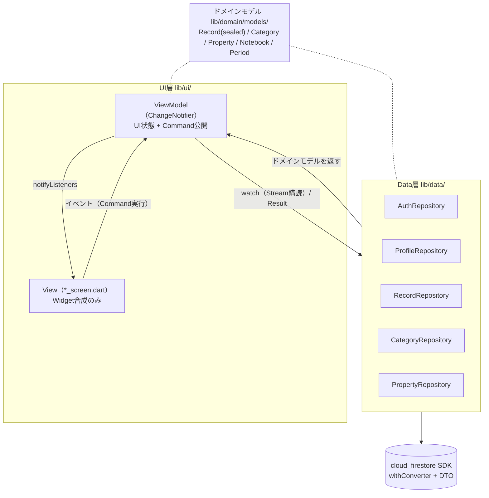
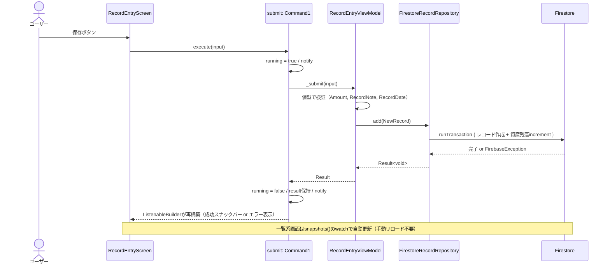

# 家計簿アプリ アーキテクチャ刷新案

- ステータス: **実施済み**(2026-11、[移行計画](./202608_architecture_migration_plan.md)のPR1〜PR9で実装)。本書は提案 v1.1 時点のスナップショットであり、実装の過程で変わった点は移行計画に記録している。現在のアーキテクチャのライブの正は [`docs/architecture.md`](../architecture.md)・[`docs/style_guide.md`](../style_guide.md)
- 作成日: 2026-08-18(初版) / 同日レビュー反映(世代数の訂正・bikini実装済みの訂正・ID方針の変更・論点O1〜O6の決定・D7補足の追記)
- スタンス: 過去の経緯(v2移行計画・style_guide)は一旦脇に置き、**Flutter公式の App architecture ガイドを物差しにゼロベースで設計**する。そのうえで既存資産との距離を最後に確認する。
- 根拠とした調査(いずれも2026-08-18実施):
  1. 既存アプリの全容調査(全179 Dartファイル / 手書き10,331行)
  2. Flutter公式 [App architecture](https://docs.flutter.dev/app-architecture) セクション全ページ(2026-05-05更新版)
  3. エコシステム現状調査(Flutter 3.47.0 / Dart 3.13.0時点のパッケージメンテ状況)

---

## 0. TL;DR

公式ガイドのMVVMをほぼそのまま採用する。ただし「このアプリは1人開発・手書き1万行・CRUD中心」という実像に合わせ、**層と概念の数を意図的に減らす**。

| 論点 | 決定 |
|---|---|
| 全体構造 | **MVVM 2層**(UI層 + Data層)。ドメイン層(UseCase)は置かない |
| DI | **provider に一本化**(get_it 廃止)。ViewModelはルート定義内で生成 |
| 状態管理 | **ChangeNotifier + 公式Commandパターン**(Result内蔵版) |
| エラー処理 | **自作 `Result<T>`(sealed class)**。dartz / Either 全廃 |
| 個人/共有ノート | **`Notebook` 抽象で単一実装に統一**(Personal/Shared二重実装を解消) |
| Firestore | **`snapshots()` によるwatch中心**へ転換。Service層は置かず Repository が withConverter で直接アクセス |
| ルーティング | **go_router**(タブは StatefulShellRoute) |
| モデル | freezed(sealed union)。**IDと検証を持つ値だけ**を値オブジェクト化(いずれもfreezed) |
| テスト | **Fake優先**(公式Strongly recommend)。golden資産・エミュレータ統合テストは維持 |

---

## 1. 前提: このアプリの実像

設計は規模に従うべきなので、まず現状調査から得た実像を固定する。

- **機能**: 認証、ダッシュボード、記録入力(収入/支出/振替)、カレンダー(月次/日次)、資産管理、カテゴリ管理(予算付き)、予算ビュー(暦月/16日始まり月度)、設定(ユーザー名)。**典型的なCRUD + 期間集計**のアプリ。
- **規模**: 手書き約10,300行・179ファイル。うち旧世代(feature+presentation+data+entity)が約6,200行、v2が約3,460行。
- **バックエンド**: Firestore(スキーマは `docs/firestore_schema.md`)。`personalNotes/{uid}` と `sharedNotes/{pairId}` は**同一構造の6サブコレクション**を持つ。
- **開発体制**: 1人 + AIエージェント。チーム間協業のための厳密な境界より、**迷いなく書ける単純さ**が価値を持つ。
- **現状の負債**(詳細は調査レポート):
  - 新旧2世代のアーキテクチャが共存(旧: UseCase+Interactor+get_it とそのpresentation / 新: v2のMVVM)。DIグラフも2系統(get_it と provider)が独立して並存
  - エラー型が3種類(`ExceptionOr`, `Either`, `Failure`)、`result_dart` は宣言のみ未使用
  - リアルタイム同期はペア検知の1箇所のみ。他は全て一発 `get()` + `FutureBuilder` で、他端末の変更が自動反映されない
  - 資産残高の整合性トランザクションは旧世代のみに実装、v2未移植
  - ドキュメント上の制約(未来日付禁止・削除時の参照整合性・振替の同一資産禁止)の多くがクライアント側未実装
  - バグ発見: 共有ノートの振替が `personalNotes/{pairId}/transfers` に誤って読み書きされる(`firebase_transfer_record_repository.dart:81`、別タスクとして切り出し済み)

### 直近の機能追加がアーキテクチャに求めるもの

前月16日〜今月15日で区切る「月度」でのカテゴリ別支出集計(`docs/features/002-bikini/`)は**実装済み**で、旧世代の予算ビューア(`budget_viewer_page.dart` + `custom_cycle.dart`)が期間指定(begin/end)のUseCaseで実現している。一方、v2のRepositoryインターフェースは `fetchMonthly(DateTime)` の**暦月固定で月度を表現できない**。新設計にこの機能を運ぶには「集計期間」を第一級の概念に昇格させる必要がある(→ D7 の `Period` 型)。

---

## 2. 物差し: Flutter公式ガイドの要点

[公式recommendations](https://docs.flutter.dev/app-architecture/recommendations)(2026-05-05更新)の推奨度表の要約。本提案の各決定はこの表を根拠にする。

| カテゴリ | 推奨事項 | 推奨度 |
|---|---|---|
| 関心の分離 | Data層とUI層を明確に分ける | **Strongly recommend** |
| 関心の分離 | Repositoryパターンを使う | **Strongly recommend** |
| 関心の分離 | MVVM(View + ViewModel)を使う | **Strongly recommend** |
| 関心の分離 | Widgetにロジックを置かない | **Strongly recommend** |
| 関心の分離 | `ChangeNotifier`/`Listenable` でWidget更新 | Conditional |
| 関心の分離 | ドメイン層を使う | **Conditional** |
| データ | 単方向データフロー | **Strongly recommend** |
| データ | ユーザー操作は `Command` で扱う | Recommend |
| データ | イミュータブルなデータモデル | **Strongly recommend** |
| データ | `freezed` / `built_value` でモデル生成 | Recommend |
| データ | APIモデルとドメインモデルの分離 | Conditional |
| 構造 | DIを使う(**providerパッケージを名指しで推奨**) | **Strongly recommend** |
| 構造 | `go_router` でナビゲーション | Recommend |
| 構造 | 命名規約の標準化 | Recommend |
| 構造 | Repositoryは抽象クラスを切る | **Strongly recommend** |
| テスト | コンポーネント単位+結合の両方をテスト | **Strongly recommend** |
| テスト | **Fakeを作ってテストする**(Fake前提の設計) | **Strongly recommend** |

補足として押さえた公式の立場:

- **ドメイン層(UseCase)は「複数Repositoryの合成」「極めて複雑なロジック」「複数ViewModelでの再利用」のいずれかが生じた場合のみ**導入する([guide](https://docs.flutter.dev/app-architecture/guide))。CRUD中心のアプリには不要と明言。
- エラー処理は [Result パターン](https://docs.flutter.dev/app-architecture/design-patterns/result): Dartの例外はunchecked(捕捉が強制されない)なので、`sealed class Result<T>` + switch網羅で処理を強制する。**公式例は数十行の自作クラスで、dartz/Eitherへの言及はゼロ**。
- [Command パターン](https://docs.flutter.dev/app-architecture/design-patterns/command): `running` / `error` / `result` を一元管理し多重実行を防ぐ。公式実装は `Command0` / `Command1`。
- ViewModelは**Providerに登録せず、ルート(GoRoute builder)で都度生成**し、`context.read()` でRepositoryを注入([case-study/dependency-injection](https://docs.flutter.dev/app-architecture/case-study/dependency-injection))。
- [offline-first](https://docs.flutter.dev/app-architecture/design-patterns/offline-first): Repositoryが「ローカル/リモートを問わない単一のデータアクセス点」となり、**Streamでデータを提示する**戦略を紹介。Firestoreのリアルタイムリスナーは「Data層起点のデータフロー」として公式概念にそのまま合致する。

エコシステムの現在地(2026-08-18確認):

- provider 6.1.5(公式がDI推奨を維持。安定・完成品)/ go_router 17.5(feature-complete宣言はあるがflutter.dev公式のまま活発)/ freezed 3.2 / FlutterFire三点セットは前日更新の活発さ
- **dartz は2021-12から未更新**・公式言及ゼロ。riverpod 3.4はコミュニティの主流だが公式recommendationsには登場しない
- Dart 3.13 で primary constructors が安定化。sealed class / パターンマッチングはDart 3標準で、Result型の自作に追加依存は不要

---

## 3. 提案する全体像

### 3.1 レイヤー構造



- 依存方向は UI → Data の一方向。ドメインモデルは両層から参照される共有語彙。
- **UseCase層は置かない**(公式Conditional、現状該当条件なし)。集計などの複数ViewModelで使うロジックは「ドメインモデル上の純粋関数」として置く(例: `BudgetSummary.from(categories, expenses)`)。将来、公式の導入基準を満たしたときに初めて `domain/usecases/` を作る。

### 3.2 フォルダ構成(公式 compass_app 準拠)

```text
lib/
├── main.dart                     # Firebase初期化 + MultiProvider + MaterialApp.router
├── config/
│   └── dependencies.dart         # Provider登録一覧（main.dartから分離）
├── routing/
│   ├── router.dart               # GoRouter定義。ViewModel生成はここ
│   └── routes.dart               # パス定数
├── domain/
│   └── models/                   # ドメインモデル（すべてfreezed）
│       ├── record.dart           # sealed: IncomeRecord / ExpenseRecord / TransferRecord
│       ├── record_id.dart        # ID値オブジェクト。対応するモデルの隣に1型1ファイルで置く
│       ├── category.dart         # IncomeCategory / ExpenseCategory（予算含む）
│       ├── category_id.dart
│       ├── property.dart
│       ├── property_id.dart
│       ├── profile.dart          # PublicProfile / PairStatus（user_id.dart / pair_id.dart も同様）
│       ├── notebook.dart         # sealed: PersonalNotebook / SharedNotebook
│       └── period.dart           # 集計期間（暦月・16日始まり月度）
├── data/
│   └── repositories/             # 抽象 + Firestore実装 + DTO を機能ごとに同居
│       ├── auth/
│       ├── record/               # record_repository.dart / firestore_record_repository.dart / record_dto.dart
│       ├── category/
│       ├── property/
│       ├── profile/
│       └── firestore_shared/     # notebook_paths.dart / transaction_runner.dart
├── ui/
│   ├── core/                     # テーマ、共通Widget（loading / error / number_field）
│   ├── auth/
│   ├── shell/                    # BottomNavigationBar + Drawer（ノート切替）
│   ├── dashboard/
│   ├── record_entry/
│   ├── calendar/                 # 月次 + 日次
│   ├── properties/
│   ├── categories/
│   ├── budget/
│   └── settings/
│       ├── settings_screen.dart
│       ├── settings_view_model.dart
│       └── widgets/
└── utils/
    ├── result.dart               # Result<T>（公式パターン）
    └── command.dart              # Command0 / Command1（公式パターン）
```

- 各UIフィーチャーは `<feature>_screen.dart` + `<feature>_view_model.dart` + `widgets/`。現行の `page.dart` / `view_model.dart` 方式でも成立するが、**ファイル名がリポジトリ内で一意**になる命名の方がエディタ/エージェントの検索性が高い。
- Repository抽象の置き場は公式compass準拠で `data/repositories/` に実装と同居させる(現style_guideの `domain/repositories` 分離から変更)。抽象と実装を分けるファイルは維持しつつ、「見る場所」を1つにする。

---

## 4. 設計決定(D1〜D10)

各決定は「決定 / 理由 / 既存との差」で記す。

### D1. MVVM 2層。ドメイン層(UseCase)は置かない

- **決定**: UI層(View + ViewModel、1:1)とData層(Repository)の2層 + 共有ドメインモデル。UseCase/Interactorは作らない。
- **理由**: 公式がドメイン層をConditionalと明言し、導入基準(複数Repo合成・複雑ロジック・複数VM再利用)を示している。現アプリで基準に該当するのは予算集計程度で、それは純粋関数で足りる。旧世代のUseCase+Interactor 39ファイルが「Repositoryを呼ぶだけの薄い箱」に終わった実績も、この規模ではUseCase層が働かないことの傍証。
- **既存との差**: `lib/feature/`(36ファイル)全廃。v2の `domain/usecases/`(スタブ1件)も作らない。

### D2. DIはproviderに一本化。ViewModelはルートで生成

- **決定**: `main.dart`(実体は `config/dependencies.dart`)の `MultiProvider` にRepositoryを登録。ViewModelは**Providerに登録せず**、`GoRoute.builder` 内で `XxxViewModel(recordRepository: context.read(), ...)` と生成してScreenに渡す。get_itは廃止。
- **理由**: 公式Strongly recommend + provider名指し。「Repositoryはアプリ全域・長寿命、ViewModelは画面と同寿命」という寿命の違いをDI機構の違い(Provider登録 vs ルートで生成)で表現するのが公式のやり方で、現v2の `SettingsViewModel` らが既にこの形に近い。2系統のDIグラフ並存(現状の最大の複雑性源)が解消される。
- **既存との差**: `lib/util/service_locator/` 全廃。`sl<UseCase>()` 呼び出しの撤去。riverpodへの乗り換えは見送り(§9 O3参照)。

### D3. ChangeNotifier + 公式Commandパターン

- **決定**: ViewModelは `ChangeNotifier`(単純なら `ValueNotifier`)。ユーザー操作起点の非同期処理は公式実装準拠の `Command0` / `Command1` で包み、`running` / `error` / `result` をViewに公開する。Viewは `ListenableBuilder` で購読。
- **理由**: 公式case-studyの実装そのまま。追加パッケージ不要でFlutter SDKだけで完結する。現v2の `AsyncCommand` と同型なので思想の連続性もある。
- **既存との差**: `AsyncCommand` → 公式シグネチャの `Command` へ置換。最大の違いは**Commandが `Result<T>` を内蔵する**こと(現実装のTODOコメント「Eitherを返すよう変えたい」がまさにこれ)。旧世代の `*State` クラス(手動fetch + フラグ管理)は全廃。

### D4. エラー処理は自作 `Result<T>`。dartz全廃

- **決定**: [公式Resultパターン](https://docs.flutter.dev/app-architecture/design-patterns/result)の `sealed class Result<T>`(`Ok<T>` / `Error<T>`)を `utils/result.dart` に自作(約30行)。Repositoryの単発操作は `Future<Result<T>>` を返し、ViewModel(Command内)で `switch` 網羅処理する。dartz・`ExceptionOr`・`Failure`・result_dartをすべて廃止。
- **理由**: dartzは2021年から未更新で公式言及もない。Dart 3のsealed + パターンマッチングで同じ安全性が標準機能だけで得られ、switchの網羅性チェックがコンパイラで効く。現行の「Either → rethrow → Commandがcatch」という3段変換(architecture.mdが1章を割いて正当化していた歪み)が消え、**Repository → Command → View まで例外を投げない一本道**になる。
- **既存との差**: 83ファイルが依存するdartzの除去。機械的な置換が主(`Left/Right` → `Error/Ok`、`fold` → `switch`)。

```dart
// utils/result.dart（公式パターン）
sealed class Result<T> {
  const Result();
  const factory Result.ok(T value) = Ok._;
  const factory Result.error(Exception error) = Error._;
}

final class Ok<T> extends Result<T> {
  const Ok._(this.value);
  final T value;
}

final class Error<T> extends Result<T> {
  const Error._(this.error);
  final Exception error;
}
```

### D5. `Notebook` 抽象で個人/共有の二重実装を統一

- **決定**: `sealed class Notebook { PersonalNotebook(UserId uid) / SharedNotebook(PairId pairId) }` をドメインモデルに置き、Firestoreのルートパス解決だけを `notebook_paths.dart` に集約する。Repository実装は**1データ種別につき1クラス**で、コンストラクタに `Notebook` を受け取る。どのノートを開いているかは `SelectedNotebook`(ChangeNotifier、アプリ状態)が持ち、`ProxyProvider` がRepositoryを組み替える。
- **理由**: `personalNotes/{uid}` と `sharedNotes/{pairId}` はサブコレクション構造が同一で、クライアントから見た違いは**ルートパスだけ**。現状はこれをPersonal/Shared別クラスで実装したため、リポジトリ12個・マーカーインターフェース12個・Service重複が生まれ、共有側だけ実装が追いつかない(v2の共有write未実装、旧世代の共有振替パスバグ)という**二重実装特有の劣化**が起きている。単一実装なら共有ノートは自動的に個人ノートと同機能になる。
- **既存との差**: `FirestorePersonalXxxRepository` / `FirestoreSharedXxxRepository` の統合。`repository_selector.dart` / `UserInfo.repoId()` の廃止。ノート切替時はUIシェルを `KeyedSubtree(key: ValueKey(notebook))` で作り直す(切替は稀な操作なので、Streamの繋ぎ替えより「作り直し」の単純さを取る)。

### D6. Firestoreは watch(snapshots)中心。Service層は置かない

- **決定**:
  1. 一覧系の読み取りは `snapshots()` ベースの `Stream` をRepositoryが公開(`watchPeriod(Period)`, `watchAll()`)。ViewModelが購読して状態を更新する。書き込み・単発読みは `Future<Result<T>>`。
  2. 現v2のようなServiceクラス階層(コレクション単位の薄いラッパ)は**作らない**。Repository実装が `withConverter<XxxDto>` を使ってFirestoreに直接アクセスする。共有するのはパス解決(`notebook_paths.dart`)とトランザクション実行(`transaction_runner.dart`)のみ。
- **理由**:
  - watch化: このアプリは**二人で同じノートを見る**のが中核価値なのに、現状は一発getのため相手の変更が画面再訪まで見えない。Firestoreはリスナー+オフラインキャッシュ(モバイルはデフォルト有効)を無料で提供しており、公式offline-firstパターンの「RepositoryがStreamで提示する」戦略と一致する。手動 `_reloadState()` 網も消える。
  - Service層廃止: 公式のService定義は「外部クライアントの薄いラップ」だが、cloud_firestore SDK自体が型付きクライアントであり、withConverterでDTO境界も作れる。現v2ではService+Repositoryの2段が28ファイル/1,659行を占め、テストでもFirestoreのメソッドチェーンをmockitoで1つずつスタブする苦行を生んでいた。**Fake境界はRepository抽象に置く**(公式testing準拠)ので、中間層はテスト容易性にも寄与していない。公式ケーススタディ(HTTP前提)からの意図的な逸脱として明記する。
- **既存との差**: `v2/data/services/` 廃止。DTO(freezedの `*Dto`)はRepository実装ファイル群の中に置く。エミュレータでは `persistenceEnabled: false` を維持(現行どおり)、本番はプラットフォームデフォルト(モバイル=永続化有効)。

### D7. 暗黙仕様をドメインモデルに明文化する

- **決定**: `docs/firestore_constraints.md` にあってクライアント未実装の制約を、新ドメインモデルの責務として実装する。
  - `Period` 型: `Period.calendarMonth(y, m)` / `Period.fiscalMonth(y, m, startDay: 16)`(半開区間 `[start, end)`)。Repositoryの期間指定はすべて `Period` を受ける → **002-bikini がインターフェース変更なしで実装可能になる**
  - 検証付き値型(§D9): 金額>0、メモ≤100字、カテゴリ/資産名1..20字、予算≥0、**日付は未来を拒否**(UIのDatePickerも当日までに制限)
  - `TransferRecord` に `@Assert('fromPropertyId != toPropertyId')`
  - カテゴリ/資産の削除ガード: Repository実装内で参照レコードの存在を確認し、存在すれば `Result.error(CategoryInUseException())` を返す
  - 資産残高の整合性: **RecordRepositoryが所有**する。`add()` / `delete()` は `runTransaction` でレコード書き込みと資産残高の増減を不可分に行う(constraints.mdどおり無条件に反映する。現行コードの `hasCheckedOut` ゲートは、フィールドごと未使用と確認されたため設計から外す — スキーマ互換のため書き込み時に `false` を入れるのみ)。PropertyRepositoryは資産のCRUDと参照のSSOTだが、残高の増減はレコード操作の付随効果としてRecordRepository側が書く——この越境は「残高=レコードの派生値」という業務ルールの表現として意図的に許す
  - 削除済み参照へのフォールバック(現行の `deletedCategory` センチネル相当)は維持: 参照解決に失敗したレコードは「削除済みカテゴリ」として表示する
- **理由**: 「テストが仕様書」という方針(style_guide)を実効化するには、仕様がドメインの型と関数に現れている必要がある。制約が型になっていれば、AIエージェントに対する仕様伝達も正確になる。
- **既存との差**: 未来日付はレビューで**禁止**に決定(現行UIは+365日先まで入力できたため挙動変更になる)。

#### D7補足: 残高更新をUseCaseにしない理由(2026-08-18の議論の記録)

「レコード作成/削除 + 資産残高更新」は複数Repositoryにまたがって見えるためUseCaseの適用候補に見えるが、ここで守るべきは調整ではなく**原子性**であり、原子性はストレージの性質としてデータ層の内側でしか実現できない。UseCase経由にする形はいずれも欠陥を持つ:

- UseCaseが2つのRepositoryを順に呼ぶ → 2回目の書き込み失敗で不整合が残り、守りたかった原子性そのものが守れない
- 両Repositoryが共通のトランザクション文脈を受け取る → `cloud_firestore` の `Transaction` がドメイン層を通過して実装詳細が漏れる。隠すにはUnit of Workパターンが必要で、この規模のアプリの1つの不変条件には過剰
- 原子的な単一データ層メソッドをUseCaseが包むだけ → 旧世代Interactor(薄い箱)の再来

よって分担は「**ルールはドメイン**(`record.balanceEffects` が増減内容を算出)、**原子的実行はRecordRepository**(`runTransaction`)」とする。トランザクション境界=整合性境界であり、境界の内側を守るのは調整役ではなくRepositoryの仕事。公式のドメイン層導入基準にある「複数Repositoryのデータマージ」は読み取り側(表示用合成)の話であり、原子的書き込みには当たらない。将来、レコード追加の入口が複数化(一括インポート、定期記録等)したり副次処理(予算アラート等)が増えた場合は、原子的Repositoryメソッドを**囲む**UseCaseを追加する — その場合も原子性の継ぎ目はデータ層に残る。

### D8. ルーティングはgo_router

- **決定**: go_router 17.x を導入。タブは `StatefulShellRoute.indexedStack`、編集画面(カテゴリ/資産エディタ、日次詳細)はサブルート。ViewModel生成はD2のとおりルートbuilder内。
- **理由**: 公式Recommend(「90%のアプリに適する」)。style_guide自身も「そのうちGoRouterに移行したい」と記載済み。認証状態による `redirect` も宣言的に書ける。go_routerはfeature-complete宣言済みだがflutter.dev公式メンテが継続しており、この規模のアプリに必要な機能はすべて安定領域。
- **既存との差**: `Navigator.push` 直書きと `MainPage` の手動タブ管理を置換。

### D9. モデル戦略: freezedに統一した sealed union + 値オブジェクト

- **決定**:
  - エンティティ(Record, Category, Property, Profile)は freezed。レコードは `sealed class Record` のunionにする(下記)
  - ID類(`RecordId`, `CategoryId`, `PropertyId`, `UserId`, `PairId`)も **freezedの値オブジェクト**とする。extension typeは実行時に型が消えて素の `String` になり、実行時の型検査・取り違え検出を捨てることになるため不採用(レビューで決定)
  - IDのファイルは寄せ集めの `ids.dart` にせず、**対応するモデルの隣に1型1ファイル**(`record_id.dart` 等)で置く。モデルの追加・削除時に触る箇所がそのモデルの周辺で完結する(凝集性)
  - 検証を持つ値も値オブジェクトにする: `Amount`(>0), `RecordNote`(≤100), `CategoryName` / `PropertyName`(1..20), `Budget`(≥0), `RecordDate`(未来日付拒否)。**IDでも検証でもない値はラップしない**
  - Firestore DTOはドメインと分離(公式Conditionalだが、`Timestamp` / `{'ref': path}` というFirestore方言を閉じ込めるため採用)
- **理由**: 型安全の便益が大きいのはID取り違え防止と制約の表明であり、この2種に値オブジェクトを絞ることで、現v2で17個に膨らんだ単一値VO群を意味のある集合に整理する。sealed unionは「収入/支出/振替で必須フィールドが異なる」というスキーマの実態を型で表現し、カレンダー/日次画面の「全レコード混在リスト」をswitch網羅で安全に描画できる。
- **既存との差**: VO 17個 → 11個程度(ID 5 + 検証付き値 6)に整理。`@Assert` はデバッグビルドしか効かないため、フォーム検証は値型の `static String? validate(String input)` を併設してVMから使う。

```dart
// domain/models/category_id.dart（IDは全て同形・1型1ファイル）
@freezed
abstract class CategoryId with _$CategoryId {
  const factory CategoryId(String value) = _CategoryId;
}

// domain/models/record.dart（骨子）
@freezed
sealed class Record with _$Record {
  const factory Record.income({
    required RecordId id,
    required RecordDate date,
    required Amount amount,
    required RecordNote note,
    required CategoryId categoryId,
    required PropertyId propertyId,
  }) = IncomeRecord;

  const factory Record.expense({ /* incomeと同形 */ }) = ExpenseRecord;

  @Assert('fromPropertyId != toPropertyId', '振替元と振替先は異なる資産が必要')
  const factory Record.transfer({
    required RecordId id,
    required RecordDate date,
    required Amount amount,
    required RecordNote note,
    required PropertyId fromPropertyId,
    required PropertyId toPropertyId,
  }) = TransferRecord;
}
```

### D10. テスト戦略: Fake優先、既存資産は維持

- **決定**:
  - ViewModelテスト: 手書き `FakeXxxRepository`(抽象を実装したインメモリ版)を注入した純粋ユニットテスト。**mockitoのcodegenモックからFakeへ軸足を移す**(公式Strongly recommend)
  - Repository実装テスト: Firestoreエミュレータに対する結合テストを主とする(現状のmockitoでSDKチェーンをスタブする方式は廃止。D6でService層が消えるため、モック対象そのものがなくなる)
  - Widget/goldenテスト: 現行の自作goldenハーネス(3画面幅)を維持。ルーターのモックが必要な箇所のみ mocktail を新規採用
  - Integrationテスト: 現行のユーザーストーリー形式 + エミュレータ+シードデータ方式を維持
- **理由**: 公式testingページの構成そのまま。「Fakeを前提にした設計」はRepository抽象(D2/D6)が担保する。
- **既存との差**: 新規テストはFake/mocktail。既存のmockitoテストは触るときに置き換え(全面書き換えはしない)。

---

## 5. 画面別マッピング

全画面を新アーキテクチャに射影した対応表。「watch」はStream購読、「Command」は書き込み操作。

| 画面 | ルート | ViewModel | 依存Repository | 備考 |
|---|---|---|---|---|
| サインイン | `/sign-in` | (firebase_ui_auth継続) | Auth | `redirect` で認証ガード |
| シェル(タブ+Drawer) | `/` | ShellViewModel | Profile | ペア状態をwatch(現app_home_pageのStreamBuilderを置換)。Drawerでノート切替 |
| ダッシュボード | `/dashboard` | DashboardViewModel | Record, Profile | 当月 `watchPeriod`。集計はドメイン純粋関数 |
| 記録入力 | `/entry` | RecordEntryViewModel | Category, Property, Record | カテゴリ/資産をwatch(ドロップダウン)、`submit = Command1<NewRecord>` |
| カレンダー(月次) | `/calendar` | CalendarViewModel | Record | 月の `watchPeriod` を日別に畳み込み |
| 日次明細 | `/calendar/:date` | DailyRecordsViewModel | Record | その日の `watchPeriod` + `delete = Command1<Record>`(PR5訂正: RecordIdだけでは3コレクションのどれか特定できないため `Record` を渡す) |
| 資産 | `/properties` | PropertiesViewModel | Property | watch + CRUD Command。エディタはサブルート |
| カテゴリ | `/categories` | CategoriesViewModel | Category | watch + CRUD Command(収入/支出タブ)。削除ガードはRepository側 |
| 予算 | `/budget` | BudgetViewModel | Category, Record | `Period` 切替(暦月/月度)。実装済みの月度集計(002-bikini)を `Period` で引き継ぐ |
| 設定 | `/settings` | SettingsViewModel | Profile | 現v2実装をほぼ流用 |

Repository一覧(抽象、計5つ):

```dart
abstract class RecordRepository {
  Stream<List<Record>> watchPeriod(Period period);
  Future<Result<void>> add(RecordContent record); // 残高トランザクション込み
  Future<Result<void>> delete(Record record);     // 残高打ち消し込み
}

abstract class CategoryRepository {
  Stream<List<IncomeCategory>> watchIncomeCategories();
  Stream<List<ExpenseCategory>> watchExpenseCategories();
  Future<Result<void>> add(...);
  Future<Result<void>> update(...);
  Future<Result<void>> delete(CategoryId id);     // 参照ガード込み
}

abstract class PropertyRepository { /* watchAll + CRUD、削除は参照ガード込み */ }
abstract class ProfileRepository  { /* userName読み書き + Stream<PairStatus> watchPairStatus() */ }
abstract class AuthRepository     { /* currentUser + Stream<UserAuth> authStateChanges() */ }
```

> **PR5での追記修正(2026-08-31)**: `RecordRepository` の2メソッドは当初案から変更した。`delete(RecordId id)` はIDだけでは3コレクション(incomes/expenses/transfers)のどれを消すか特定できず実装不能のため `delete(Record record)` とする(sealed型switchでコレクション解決)。また `NewRecord` は `RecordContent` へ改名した: 残高への寄与(`balanceEffects`)はレコード内容の関数でありIDや保存状態と無関係で、「新規」という性質は型の内在ではなく `add` の引数という文脈が表す。保存済み `Record` からは `Record.content` で同じ内容を取り出し、削除の残高打ち消しはその寄与の符号反転で計算する(本節以外の `NewRecord` 表記は当時の記述として残す。経緯は移行計画書の変更履歴を参照)。

---

## 6. 代表フロー: 記録の登録

新アーキテクチャで最も密度が高いフロー(Command + Result + トランザクション)を1本通しで示す。



実装スケッチ(骨子のみ):

```dart
// ui/record_entry/record_entry_view_model.dart
class RecordEntryViewModel extends ChangeNotifier {
  RecordEntryViewModel({
    required RecordRepository recordRepository,
    required CategoryRepository categoryRepository,
    required PropertyRepository propertyRepository,
  }) : _recordRepository = recordRepository {
    submit = Command1(_submit);
    _subscriptions = [
      categoryRepository.watchExpenseCategories().listen((v) {
        _expenseCategories = v;
        notifyListeners();
      }),
      propertyRepository.watchAll().listen((v) { /* 同様 */ }),
    ];
  }

  late final Command1<void, RecordDraft> submit;

  Future<Result<void>> _submit(RecordDraft draft) async {
    final record = draft.toNewRecord(); // 値型検証はここで確定
    return _recordRepository.add(record);
  }

  @override
  void dispose() {
    for (final s in _subscriptions) { s.cancel(); }
    super.dispose();
  }
}
```

```dart
// data/repositories/record/firestore_record_repository.dart（骨子）
class FirestoreRecordRepository implements RecordRepository {
  FirestoreRecordRepository(this._db, this._notebook);
  final FirebaseFirestore _db;
  final Notebook _notebook; // D5: 個人/共有はパス解決だけの差

  @override
  Future<Result<void>> add(NewRecord record) async {
    try {
      await _db.runTransaction((tx) async {
        final doc = _recordCollection(record.type).doc();
        tx.set(doc, RecordDto.fromDomain(record));
        for (final (propertyId, delta) in record.balanceEffects) {
          tx.update(_propertyDoc(propertyId), {
            'amount': FieldValue.increment(delta),
          });
        }
      });
      return const Result.ok(null);
    } on FirebaseException catch (e) {
      return Result.error(RepositoryException(e));
    }
  }

  @override
  Stream<List<Record>> watchPeriod(Period period) {
    // incomes / expenses / transfers の3つのsnapshots()を結合して
    // 日付範囲 [period.start, period.end) でフィルタ
  }
}
```

DI(骨子):

```dart
// config/dependencies.dart
List<SingleChildWidget> providers() => [
  ChangeNotifierProvider(create: (_) => SelectedNotebook()),
  Provider<AuthRepository>(create: (_) => FirebaseAuthRepository()),
  // Notebookに依存するRepositoryはProxyProviderで組み替え（実装クラスは各1つ）
  ProxyProvider2<SelectedNotebook, UserAuth, RecordRepository>(
    update: (ctx, note, user, _) =>
        FirestoreRecordRepository(ctx.read(), note.resolve(user)),
  ),
  // Category / Property も同形
];

// routing/router.dart
GoRoute(
  path: Routes.entry,
  builder: (context, state) => RecordEntryScreen(
    viewModel: RecordEntryViewModel(
      recordRepository: context.read(),
      categoryRepository: context.read(),
      propertyRepository: context.read(),
    ),
  ),
),
```

---

## 7. パッケージ棚卸し

2026-08-18時点の最新版・メンテ状況の調査に基づく。

| パッケージ | 現状 | 処遇 | 理由 |
|---|---|---|---|
| provider | ^6.0.1 | **維持**(6.1.x) | 公式DI推奨。安定した完成品 |
| freezed / freezed_annotation | ^3.0.0 | **維持** | 公式Recommend。sealed union に必須 |
| cloud_firestore / firebase_core / firebase_auth | 最新系 | **維持** | 活発。withConverterは現役推奨API |
| intl / logging / fl_chart | - | **維持** | fl_chartは予算グラフ(未配線資産)の再配線で活きる |
| firebase_ui_auth | ^3.1.0 | **当面維持**(要監視) | リリース間隔が数ヶ月空く傾向あり。auth機能をui/auth/に隔離し、差し替え可能に保つ |
| **go_router** | なし | **新規導入**(17.x) | 公式Recommend。style_guideの既定路線 |
| dartz | ^0.10.1 | **廃止** | 2021年から未更新。D4のResultで置換 |
| result_dart | ^2.1.0 | **廃止**(未使用のまま) | 自作Result(公式パターン30行)で足りる。依存を増やさない |
| get_it | ^9.2.1 | **廃止** | D2でproviderに一本化 |
| equatable | ^2.1.0 | **廃止** | freezedに統一(使用3ファイルのみ) |
| uuid | ^4.6.0 | **廃止** | Firestoreの `doc().id` で代替(オフラインでも採番可) |
| mockito | ^5.4.4 | **段階的縮小** | 新規テストはFake+mocktail。既存テストは触るときに移行 |
| mocktail | なし | **新規導入**(dev) | 公式case-study採用。codegen不要 |

> **PR9での追記(2026-11-08)**: 移行の完了時点で、次の3つは上の処遇と異なる結果になった(経緯は移行計画書のPR9欄と変更履歴を参照)。(1) **fl_chart は除去した**。未配線だった予算グラフ一式を削除し、作り直すなら新アーキテクチャの機能として別PRで行うことにしたため、「予算グラフの再配線で活きる」は採らなかった (2) **mockito は全廃した**。mockitoを使っていたテストは、移行の過程で旧世代・v2のコードとともにすべて削除され(最後に残ったのはPR9で消した `test/v2/`)、利用者が0になった(「段階的縮小」「既存テストは触るときに移行」は論点でなくなった) (3) **mocktail は導入しなかった**。全テストが手書きのFakeで足り、ルーターのモックが要る箇所も生じなかった。

---

## 8. 既存資産との距離と進め方

ゼロベースで設計した結果は、幸い**v2の延長線上**にある。フルスクラッチではなく「v2を最終形に鍛え直しつつ全画面を移す」戦略が成立する。

**そのまま活きる資産**: 検証ルール(VOのAssert群)、Firestore DTOモデル、goldenテストハーネスと48枚のgolden、integrationテストのシードデータとユーザーストーリー、settings/dashboardのViewModel構造、未配線だった予算グラフ(fl_chart)一式。

**v2 → 最終形の主な差分**:

1. `lib/v2/` を解消し公式構造(`lib/ui`, `lib/data`, `lib/domain`)へ配置(ディレクトリ名から「世代」を消す)
2. `Either` → `Result` / `AsyncCommand` → 公式 `Command`
3. Service層をRepositoryに畳み込み、Personal/Shared実装を `Notebook` で統一
4. 一発get → `snapshots()` watch
5. get_it全廃・go_router導入
6. 旧世代(feature / 旧presentation / 旧data / entity)は画面移行のたびに削除

**進め方の原則**(詳細計画は合意後に別ドキュメント化):

- ストラングラー方式で**画面単位**に移行し、移行した画面の旧実装を即削除する(「動く標的」化した前回計画の反省: レイヤー横断の一斉移行フェーズを組まない)
- 最初に土台(`Result` / `Command` / `Period` / `Notebook` / ルーター骨格)を小さく作り、**settings → dashboard**(既存v2の小画面)で型を確立してから、entry → calendar → properties/categories → budget の順に主要画面を移す
- 各画面の移行完了条件: golden + VMユニットテスト + 該当ユーザーストーリーのintegrationが緑、旧実装削除済み

---

## 9. 論点と決定(2026-08-18 レビューで確定)

初版で「未解決」として提示した論点は、レビューで以下のとおり決定した。

- **O1. 未来日付 → 禁止**。`RecordDate` が未来日付を拒否し、UIのDatePickerも当日までに制限する(`firestore_constraints.md` の記載に合わせる。現行UIは+365日先まで入力できたため挙動変更)。
- **O2. watchの適用範囲 → 取得系は一律watch**。個人/共有でコードパスを分けない。
- **O3. DI/状態管理 → provider続投**。riverpodへは乗り換えない。
- **O4. 認証UI → firebase_ui_auth継続**。`ui/auth/` に隔離して差し替え可能性だけ保つ。
- **O5. 共有ノートの書き込み → 個人と対等にする**。`Notebook` 統一(D5)の自然な帰結。
- **O6. hasCheckedOut → 設計から外す**。追加されたが使われていないフィールドと確認。残高反映はレコード作成/削除で無条件に行い(D7)、フィールドはスキーマ互換のため `false` を書き込むのみ。

## 10. 参考リンク

- [App architecture(概要)](https://docs.flutter.dev/app-architecture) / [Guide](https://docs.flutter.dev/app-architecture/guide) / [Recommendations](https://docs.flutter.dev/app-architecture/recommendations)
- [Case study: UI layer](https://docs.flutter.dev/app-architecture/case-study/ui-layer) / [Data layer](https://docs.flutter.dev/app-architecture/case-study/data-layer) / [Dependency injection](https://docs.flutter.dev/app-architecture/case-study/dependency-injection) / [Testing](https://docs.flutter.dev/app-architecture/case-study/testing)
- [Design patterns: Command](https://docs.flutter.dev/app-architecture/design-patterns/command) / [Result](https://docs.flutter.dev/app-architecture/design-patterns/result) / [Offline-first](https://docs.flutter.dev/app-architecture/design-patterns/offline-first) / [Optimistic state](https://docs.flutter.dev/app-architecture/design-patterns/optimistic-state)
- [compass_app(公式サンプル)](https://github.com/flutter/samples/tree/main/compass_app)
- 内部調査(既存アプリ全容・Flutter公式ドキュメント・エコシステム現状、2026-08-18実施)は単独ドキュメントとしては残していない。**結論はすべて本書の§1・§2・§7に反映済み**であり、詳細が必要な場合はリポジトリと上記公式リンクから再調査する
