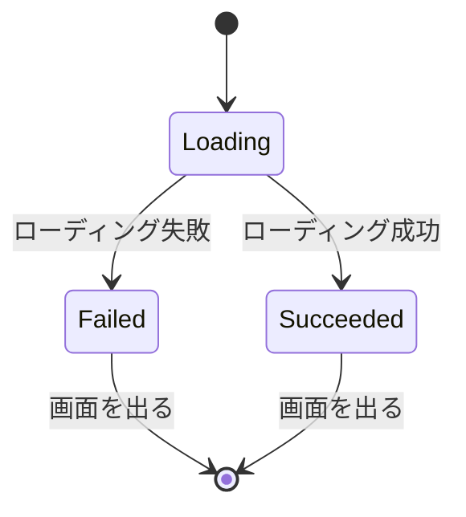
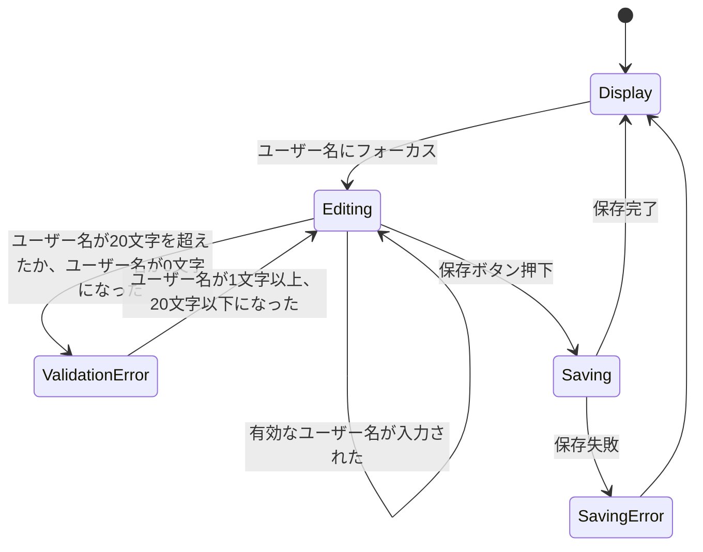

# 画面仕様

## 画面名

このプロジェクトにおいて、この画面は`設定画面`と呼称されます。

## 仕様詳細

### AppBar

- タイトルとして`設定`が表示される

### Body

Bodyの状態遷移図は以下のとおりです。

各状態で表示されるものは以下のとおりです。

|状態|表示されるもの|
|-|-|
|Loading|ローディングアイコン|
|Failed|エラーメッセージ|
|Succeeded|下記のBody Contents|

#### Body Contents

##### ユーザー名

編集可能なユーザー名が表示されます。

ユーザー名が取る状態は以下のとおりです。

各状態で表示されるものは以下のとおりです。

|状態|表示されるもの|
|-|-|
|Display|編集可能な状態のユーザー名|
|Editing|編集中のユーザー名と、押下可能な保存ボタン|
|ValidationError|編集中のユーザー名と、押下不可能な保存ボタンと、`ユーザー名は最低1文字、最大20文字にしてください`というエラーメッセージ|
|Saving|編集不可能な状態のユーザー名|
|SavingError|編集可能な状態のユーザー名と、`ユーザー名の保存に失敗しました`というスナックバー|

なお、`Display`のときに表示されるユーザー名は遷移元によって以下のようになります。

|遷移元|表示されるユーザー名|
|-|-|
|初期状態|現在のユーザー名|
|Saving|編集後のユーザー名|
|SavingError|編集前のユーザー名|
